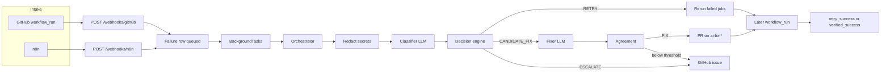

# ci-heal-backend

Confidence-based self-healing CI backend. A failed GitHub Actions run is classified, then retried, opened as a pull request, or escalated to an issue. The model never commits to the failing branch.

Develop and deploy on **Python 3.12** (`.python-version`). The package installs on 3.11 and newer.

The beginner walkthrough is with the project docs: [docs/backend/BACKEND_EXPLAINED.md](../docs/backend/BACKEND_EXPLAINED.md).

## Architecture



PRs use the failing branch as the base. The `ai-fix-*` branch is created from the failing commit SHA. A later completed run on that head branch only verifies the fix. It does not start another one.

`retries_done` counts RETRY decisions for the same repository and workflow `run_id`. `attempt` counts FIX decisions on the same repository and failing branch after the latest `verified_success` on that branch. A verified fix resets the count. `MAX_HEAL_ATTEMPTS` (default 3) applies to that streak.

## Quick start

Windows PowerShell, from this directory:

```powershell
python -m venv .venv
.\.venv\Scripts\Activate.ps1
pip install -e ".[dev]"
copy .env.example .env
python -m uvicorn app.main:app --reload
```

Use `python -m uvicorn`. On this machine `uvicorn.exe` can be blocked by Windows Application Control.

Open http://127.0.0.1:8000/health and http://127.0.0.1:8000/docs.

Replay one fixture offline. This uses an in-memory database and forces dry-run, so it does not write `ci_heal.db` or a verified outcome:

```powershell
python scripts/replay_failure.py fixtures/dependency.log
python scripts/replay_failure.py --llm http fixtures/secrets.log
```

`--llm http` calls the classifier and fixer URLs in the environment. GitHub is still mocked.

Checks:

```powershell
ruff check .
pytest
```

## Environment

Every field lives in `.env.example`. A test fails if that file and `Settings` drift apart. Names are case-insensitive.

| Variable | Default | Purpose |
| --- | --- | --- |
| `APP_NAME` | `ci-heal-backend` | Service name on `/health` |
| `APP_ENV` | `dev` | `dev` allows an empty API token and an empty webhook secret. `test` and `prod` do not |
| `LOG_LEVEL` | `INFO` | `DEBUG`, `INFO`, `WARNING`, or `ERROR` |
| `DRY_RUN` | `true` | Skip GitHub writes. See below |
| `GITHUB_TOKEN` | empty | Fine-grained PAT or GitHub App token |
| `GITHUB_API_URL` | `https://api.github.com` | GitHub API root |
| `GITHUB_TIMEOUT` | `30` | Per-attempt GitHub timeout, seconds |
| `GITHUB_MAX_RETRIES` | `2` | Extra attempts for 5xx and rate limits |
| `GITHUB_MAX_FILE_BYTES` | `100000` | Largest file that is decoded |
| `GITHUB_MAX_LOG_BYTES` | `1000000` | Largest log archive or diff |
| `GITHUB_DEFAULT_BRANCH` | `main` | Ref writes to this name are refused, along with `main` and `master` |
| `GITHUB_WEBHOOK_SECRET` | empty | HMAC secret for `X-Hub-Signature-256` |
| `GITHUB_BOT_LOGIN` | empty | Token-owner login. Those runs are ignored, except `ai-fix-*` verification |
| `N8N_SHARED_TOKEN` | empty | Required on `POST /webhooks/n8n` |
| `API_TOKEN` | empty | Bearer token for operator routes |
| `ALLOWED_REPOS` | empty | Comma-separated `owner/name`. Empty allows none |
| `WEBHOOK_MAX_BYTES` | `1000000` | Largest webhook body |
| `PIPELINE_TIMEOUT_SECONDS` | `180` | Cap for one failure |
| `PROCESSING_STALE_SECONDS` | `900` | Processing rows older than this are recovered on startup |
| `MAX_RECOVERIES` | `3` | Startup reschedules, then the row is marked error |
| `DATABASE_URL` | `sqlite:///./ci_heal.db` | SQLite or Postgres URL |
| `CLASSIFY_THRESHOLD` | `0.75` | Confidence required before a fix is attempted |
| `AGREEMENT_THRESHOLD` | `0.6` | Patch agreement required to open a PR |
| `FLAKY_THRESHOLD` | `0.75` | Confidence required to retry a flake |
| `MAX_RETRIES` | `1` | Flaky reruns before escalate |
| `MAX_HEAL_ATTEMPTS` | `3` | FIX decisions in the current streak |
| `CATEGORY_THRESHOLDS` | `{}` | JSON object of category to confidence gate |
| `CORS_ORIGINS` | localhost 5173 and 3000 | Browser origins for the dashboard |
| `CLASSIFIER_LLM_PROVIDER` | `mock` | `mock` or `http` |
| `CLASSIFIER_LLM_BASE_URL` | empty | Server root. A trailing `/v1` is accepted |
| `CLASSIFIER_LLM_API_KEY` | empty | Bearer token for the classifier |
| `CLASSIFIER_LLM_MODEL` | `local` | `model` field. Kaggle expects `local` |
| `CLASSIFIER_LLM_TIMEOUT` | `60` | Per-attempt timeout, seconds |
| `CLASSIFIER_LLM_DEADLINE` | `180` | Whole call, including retries |
| `CLASSIFIER_LLM_STREAM` | `true` | Stream the completion |
| `CLASSIFIER_LLM_MAX_RETRIES` | `2` | Extra HTTP attempts |
| `CLASSIFIER_SAMPLES` | `1` | Self-consistency samples. Use 3 with temperature above 0 |
| `CLASSIFIER_TEMPERATURE` | `0` | Classifier sampling temperature |
| `CLASSIFIER_MAX_RETRIES` | `2` | Parse re-asks. Not the flaky rerun cap |
| `CLASSIFIER_MAX_TOKENS` | `512` | Classifier completion cap |
| `FIXER_LLM_PROVIDER` | `mock` | `mock` or `http` |
| `FIXER_LLM_BASE_URL` | empty | Fixer server root |
| `FIXER_LLM_API_KEY` | empty | Bearer token for the fixer |
| `FIXER_LLM_MODEL` | `local` | Fixer `model` field |
| `FIXER_LLM_TIMEOUT` | `120` | Per-attempt timeout, seconds |
| `FIXER_LLM_DEADLINE` | `360` | Whole fixer call |
| `FIXER_LLM_STREAM` | `true` | Stream the completion |
| `FIXER_LLM_MAX_RETRIES` | `2` | Extra HTTP attempts |
| `FIX_CANDIDATES` | `3` | Patches whose agreement is scored |
| `FIX_TEMPERATURE` | `0.7` | 0 makes every candidate identical |
| `FIX_MAX_TOKENS` | `4096` | Fixer completion cap |
| `FIX_MAX_EDITS` | `5` | SEARCH/REPLACE blocks in one patch |
| `FIX_MAX_CHANGED_LINES` | `50` | Lines a patch may change |
| `FIX_ALLOW_WORKFLOWS` | `false` | Allow edits under `.github/workflows` |

`CLASSIFY_THRESHOLD` stays at 0.75. With three samples, confidence is the smaller of the average self-reported confidence and the fraction of samples that agreed. A 2–1 vote is about 0.667, so it escalates even when every sample reports a high confidence.

## Endpoints

| Method | Path | Auth | Purpose |
| --- | --- | --- | --- |
| GET | `/health` | none | Process is up. Includes `dry_run` |
| GET | `/health/ready` | none | Database only. 503 when the database is down. Use this as the platform health check |
| GET | `/health/llm` | none | Always 200. Body says whether each model answered `GET /v1/models` |
| POST | `/webhooks/github` | `X-Hub-Signature-256` | `workflow_run` completed. `failure` and `success` only |
| POST | `/webhooks/n8n` | `X-N8N-Token` | Small JSON body. The run is loaded from the GitHub API |
| GET | `/failures` | Bearer | Newest failures. `repo`, `processing_status`, `limit`, `offset` |
| GET | `/failures/{id}` | Bearer | One failure with classifications, patches, and decisions |
| POST | `/failures/{id}/reprocess` | Bearer | Queue again. 409 while `processing`. `?force=true` requeues a finished row |
| GET | `/decisions` | Bearer | Newest decisions. Filter by `action`, `category`, `outcome` |
| GET | `/stats`, `/stats/summary` | Bearer | Success counts. `repo`, `since`, `until`, `include_dry_run` |
| GET | `/stats/by-category` | Bearer | Same filters, grouped by category |
| GET | `/stats/by-action` | Bearer | Grouped by retry, fix, escalate |
| GET | `/stats/by-outcome` | Bearer | Grouped by outcome |
| GET | `/stats/calibration` | Bearer | Confidence and agreement bins. `bins` is 2–20, default 10 |
| GET | `/stats/timeline` | Bearer | Resolved decisions per UTC day |

`since` is inclusive and `until` is exclusive, compared with `created_at`. A success is a FIX with `verified_success`, or a RETRY with `retry_success`. Pending and error outcomes are excluded.

## Models

Both roles speak the OpenAI chat-completions shape in [docs/LLM_CONTRACT.md](docs/LLM_CONTRACT.md). `base_url` is the server root. The client appends `/v1`. A URL that already ends in `/v1` is accepted.

Kaggle, through the tunnel the team is running:

```
CLASSIFIER_LLM_PROVIDER=http
CLASSIFIER_LLM_BASE_URL=https://your-tunnel.trycloudflare.com
CLASSIFIER_LLM_API_KEY=selfheal-e2e-key
CLASSIFIER_LLM_MODEL=local
FIXER_LLM_PROVIDER=http
FIXER_LLM_BASE_URL=https://your-tunnel.trycloudflare.com
FIXER_LLM_API_KEY=selfheal-e2e-key
FIXER_LLM_MODEL=local
```

The key is the bearer token that server checks. The demo deploy uses `selfheal-e2e-key`. Streaming stays on. The tunnel drops a quiet request after about two minutes.

Groq, for the classifier, with the fixer still on Kaggle or on Groq as well:

```
CLASSIFIER_LLM_PROVIDER=http
CLASSIFIER_LLM_BASE_URL=https://api.groq.com/openai/v1
CLASSIFIER_LLM_API_KEY=gsk_replace_me
CLASSIFIER_LLM_MODEL=llama-3.3-70b-versatile
```

Gemini's OpenAI-compatible endpoint:

```
CLASSIFIER_LLM_PROVIDER=http
CLASSIFIER_LLM_BASE_URL=https://generativelanguage.googleapis.com/v1beta/openai
CLASSIFIER_LLM_API_KEY=replace_me
CLASSIFIER_LLM_MODEL=gemini-2.0-flash
```

`mock` is the default. The app boots and the tests run with no key and no network. An `http` role with an empty URL or key fails at startup.

## Dry-run

`DRY_RUN` defaults to true. Write methods on the GitHub client return before any POST or PUT. Reads still run when a real token and a real delivery are used. The replay script mocks those reads.

A dry-run records a decision with `dry_run=true` and a `dry-run://` URL. Nothing is pushed, so GitHub never sends the verification run, and the outcome stays `pending`. Stats and calibration exclude dry-run decisions unless `include_dry_run=true`. That is why a local demo does not move the success rate.

## Database

There is no Alembic. `create_all` creates missing tables and does not alter an existing file. After a schema change, stop the app and delete `ci_heal.db`. The current schema includes `failures.ground_truth_category` and `failures.recovery_count`.

A file database uses WAL and a 5 second busy timeout. Set `ground_truth_category` only for evaluation rows. Live webhooks leave it empty. When it is set, `/stats/calibration` adds accuracy, precision, recall, a confusion matrix, and category-confidence calibration from the latest classification.

On startup, queued failures and rows left in `processing` longer than `PROCESSING_STALE_SECONDS` are scheduled again. Each time increments `recovery_count`. At `MAX_RECOVERIES` the row is marked error instead.

## Security

- `API_TOKEN` is required on `/failures`, `/decisions`, `/stats`, and reprocess when `APP_ENV` is not `dev`, and also when `APP_ENV=test`. An empty token is allowed only in `dev`.
- `GITHUB_WEBHOOK_SECRET` is checked with `hmac.compare_digest` on the raw body. An unset secret is rejected unless `APP_ENV=dev`.
- `N8N_SHARED_TOKEN` is always required. There is no dev bypass.
- `ALLOWED_REPOS` is the allowlist for both webhooks. An empty list rejects every repository.
- Use a personal access token or a GitHub App installation token. Pushes made with the default `GITHUB_TOKEN` inside GitHub Actions do not trigger workflow runs, so verification would never arrive.
- A fine-grained token on the target repository needs Contents read/write, Pull requests read/write, Issues read/write, Actions read/write, and Metadata read. Editing `.github/workflows` also needs the Workflows permission, and that path stays blocked unless `FIX_ALLOW_WORKFLOWS=true`.
- Logs are redacted before any model call. Raw webhook bodies and unredacted logs are not logged. Tokens are `SecretStr` and stay out of `repr`.

## Deployment

Render and Railway:

- Runtime: Python 3.12
- Build: `pip install .`
- Start: `python -m uvicorn app.main:app --host 0.0.0.0 --port $PORT`
- Health check path: `/health/ready`
- Set `APP_ENV=prod`, `API_TOKEN`, `GITHUB_WEBHOOK_SECRET`, `ALLOWED_REPOS`, and the GitHub token. Leave `DRY_RUN=true` until a sandbox repository is ready.

Free-tier disk is ephemeral. `sqlite:///./ci_heal.db` disappears on restart or redeploy. Use a hosted Postgres URL in `DATABASE_URL` for anything you want to keep. The image in `Dockerfile` is the same process:

```powershell
docker build -t ci-heal-backend .
docker run --env-file .env -p 8000:8000 ci-heal-backend
```

The container still needs `PORT` wiring on a platform that assigns the port. Override the command with `--port $PORT` there.

## Limitations

- A Kaggle free GPU session is on the order of 30 hours per week, and the Cloudflare tunnel drops idle requests. Streaming is on for that reason. The server is one request at a time.
- Pipeline work runs in FastAPI `BackgroundTasks` inside the web process. It is not a separate queue. A crash mid-run is recovered on the next startup, up to `MAX_RECOVERIES`.
- There are no schema migrations. Delete the SQLite file after a model change, or create a new Postgres database.
- Dry-run decisions never get real outcomes, so the default stats exclude them.
- Workflow-file edits need an extra GitHub permission and stay off by default.

## Fixtures

`fixtures/` holds one log each for a flake, a dependency error, a configuration error, and a test failure, plus a prompt-injection log and a log with fake secrets. `fixtures/labels.json` maps each filename to a `ground_truth_category`. `scripts/replay_failure.py` reads that file for the mock classifier.
